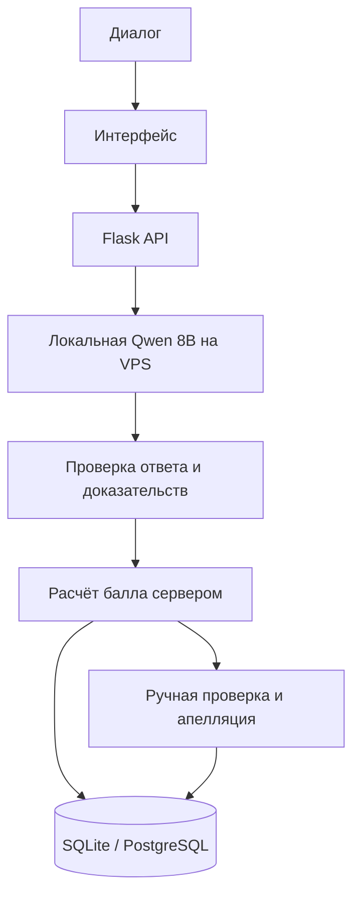

# Freedom CQA — BimBomBam

**Проверка качества диалогов поддержки с оценкой по чек-листу и доказательствами в репликах.** Загрузите чат или транскрипт звонка, проверьте работу оператора по критериям и при необходимости отправьте результат на ручную проверку или апелляцию.

[Открыть демо](https://dataitshechka.vercel.app/) · [Критерии отбора](case/criteria.txt) · [Документация API](backend/README.md)

## Как проходит оценка

1. Оператор загружает транскрипт или выбирает диалог из набора.
2. Система оценивает критерии активной версии чек-листа и связывает решения с репликами.
3. Сервер проверяет формат ответа и доказательства, затем сам рассчитывает балл с учётом весов и N/A.
4. Проверяющий изучает результат, при необходимости меняет решение или рассматривает апелляцию. История сохраняется.



## Что умеет прототип

- Импортировать транскрипты и наборы диалогов, хранить язык, канал и источник.
- Оценивать диалог по версионируемому чек-листу с бинарными, шкальными и флаговыми критериями.
- Показывать объяснение решения и привязанные к нему реплики.
- Считать балл на сервере; неполные ответы и неизвестные значения не превращать в ноль или успех.
- Поддерживать ручную проверку, апелляции, решения проверяющего и историю изменений.
- Искать и фильтровать диалоги, смотреть сводку и историю оценок.

На VPS работает локальная модель **Qwen 8B**. Она анализирует диалог по критериям чек-листа; Flask API проверяет ответы и доказательства, затем рассчитывает итоговый балл.

## Запустить локально

Нужны Python 3.11 и Node.js/npm. Команды ниже рассчитаны на PowerShell из корня репозитория.

Локальная модель — `qwen3:8b` через Ollama. Первый запуск установит portable Ollama и загрузит модель; последующие запуски используют уже установленную:

```powershell
powershell.exe -NoProfile -ExecutionPolicy Bypass -File .\scripts\local_model.ps1 -Action setup -Model qwen3:8b
# При следующих запусках:
powershell.exe -NoProfile -ExecutionPolicy Bypass -File .\scripts\local_model.ps1 -Action start -Model qwen3:8b
```

Перед запуском API укажите `OLLAMA_MODEL=qwen3:8b` в `backend/.env`.
Подробности настройки и запуска ML-оценки — в [инструкции локального запуска](docs/LOCAL_ML_RUN_RU.md).

**Терминал 1 — API:**

```powershell
Set-Location .\backend
python -m venv .venv
.\.venv\Scripts\python.exe -m pip install -r requirements-dev.txt
if (-not (Test-Path .env)) { Copy-Item .env.example .env }
.\.venv\Scripts\python.exe -m flask --app app:create_app db upgrade
.\.venv\Scripts\python.exe -m flask --app app:create_app seed-checklist
.\.venv\Scripts\python.exe -m flask --app app:create_app run --host 127.0.0.1 --port 6767
```

**Терминал 2 — интерфейс:**

```powershell
Set-Location .\frontend
npm.cmd ci
$env:PUBLIC_API_URL = 'http://127.0.0.1:6767/api'
npm.cmd start
```

Откройте `http://localhost:3000`. Проверка API: `http://127.0.0.1:6767/api/health`. Подробности запуска API — в [руководстве backend](backend/README.md).

## Технологии и структура

- **Интерфейс:** TypeScript, Tailwind CSS, нативный DOM.
- **API:** Python, Flask, SQLAlchemy, Flask-Migrate.
- **Хранилище:** SQLite локально, PostgreSQL в Docker Compose.
- **AI-оценка:** локальная Qwen 8B через Ollama; итоговый балл и проверка ссылок на реплики выполняются на сервере.

```text
backend/       API, оценивание, импорт, схема данных и миграции
frontend/      интерфейс аналитики и работы с диалогами
annotation/    инструменты подготовки и проверки разметки
data/          открытые источники и материалы ML-экспериментов
docs/          инструкции, результаты и ограничения
case/          критерии отбора и материалы задания
```

## Документация

- [Backend и API](backend/README.md) — запуск, OpenAPI, форматы и правила расчёта.
- [Frontend](frontend/README.md) — сборка и подключение к API.
- [Локальный ML-запуск](docs/LOCAL_ML_RUN_RU.md) — Ollama и запуск оценки.
- [Обучение и каскад моделей](docs/ML_TRAINING_AND_CASCADE_RU.md) — статус исследовательского пилота.
- [Локальная транскрибация](docs/ASR_LOCAL_RU.md) — опциональный сценарий для Mac на Apple Silicon.
- [Публичные источники данных](data/public_sources/SOURCES.md) — источники и сведения об атрибуции.

## Команда

- **Пинигин Артем** — фронтенд.
- **Мунира Сагындыкова** — бэкенд.
