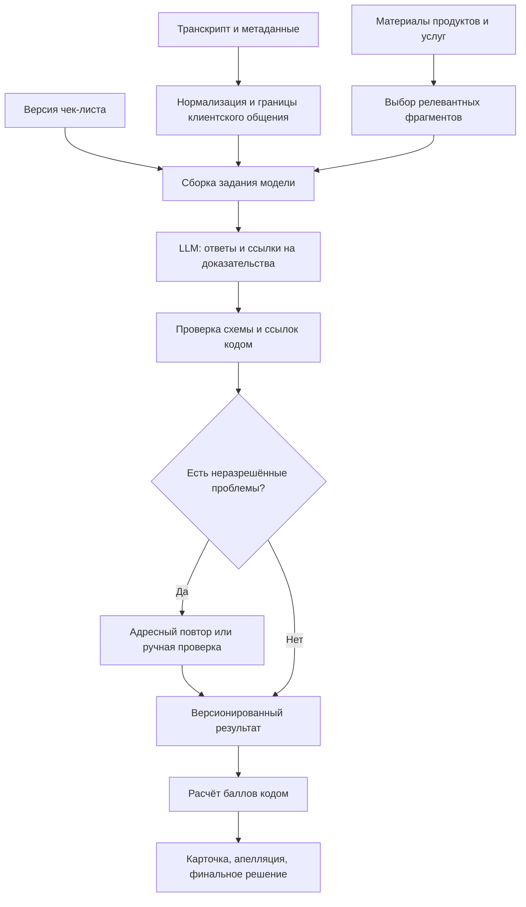

# План ML-модуля CQA для обсуждения со специалистом

> Исторический план до реализации: сведения ниже о неготовом backend и незавершённой разметке устарели. Сейчас реализован локальный оценщик, сохранён полный DEV-прогон Qwen (63 ответа и 2 ошибки), а GPT-прогон остановлен из-за отсутствия кредитов API. Текущие изменения и ограничения описаны в [LOCAL_IMPROVEMENTS_RU.md](LOCAL_IMPROVEMENTS_RU.md), запуск — в [LOCAL_ML_RUN_RU.md](LOCAL_ML_RUN_RU.md), GPT — в [GPT_EVALUATION_RU.md](GPT_EVALUATION_RU.md).

Состояние на 7 ноября 2026 года. Документ описывает предлагаемый способ реализации;
автоматический LLM-оценщик пока не реализован, модель не выбрана, измерений ML-качества нет.

## Что хотим получить

Создать сервис оценки работы оператора по произвольному настраиваемому чек-листу.
Вход — диалог, его канал и язык, версия чек-листа, при необходимости материалы брокера.
Выход — ответы по критериям, краткие обоснования, доказательства из диалога,
основания N/A, отдельный флаг грубых ошибок и итоговый балл.
Результат можно оспорить; проверяющий сохраняет решение и пересчитанный итог.

Главное ограничение архитектуры: организаторы могут изменить критерий через интерфейс.
Поэтому предлагаем задачу применения переданной инструкции к диалогу,
а не классификатор с восемью фиксированными выходами.

Наш стартовый вариант — готовая мультиязычная instruction-LLM, проверка структурированного
ответа кодом и детерминированный расчёт баллов. Дообучение рассматриваем после анализа
измеримых ошибок и появления достаточных проверенных данных.

## Что есть сейчас

| Компонент | Состояние |
| --- | --- |
| DEV-данные | 65 диалогов: 60 синтетических чатов и 5 реальных звонков |
| Языки | RU 35, KZ 15, EN 15; все 5 звонков — RU |
| Входной текст | Транскрипты уже выданы; ASR для первой версии не требуется |
| Разметка | 520 решений по критериям; 484 подтверждены пользователем, 36 uncertain |
| Происхождение | Исходные решения подготовлены ИИ; подтверждение пользователя хранится отдельно |
| Разделение данных | Независимого test нет; все 65 диалогов уже участвовали в подготовке разметки |
| Чек-листы | Официальный чатовый и отдельная адаптация для звонков по разрешению организаторов |
| Инструмент разметки | Локальный UI, доказательства, история, версии, очередь uncertain, ссылки на аудио |
| Подсчёт баллов | Реализован обычным Python-кодом |
| Продуктовые источники | Организаторы сообщили об их наличии; в оценщик они ещё не подключены |
| ML-сервис | Не реализован; production backend пока содержит только README |
| Основной frontend | Заготовка React; инструмент разметки работает отдельно |

Подтверждение 484 решений — зафиксированное сообщение пользователя о выполненной проверке,
а не измеренная точность и не доказательство независимой двойной разметки каждого примера.
Флаг `eligible_for_reference` — технический фильтр пригодности записи по заполненности и
проверкам, а не сертификат качества разметки. Для всех звонков в исходной AI-версии
`audio_reviewed=false`: голосовые характеристики моделью не оценены.
Числа отражают текущий снимок; после работы человека ориентируемся на живую очередь.

Важные существующие файлы:

- `annotation/checklist.official.json` — чатовые критерии, веса, шкалы и N/A.
- `annotation/checklist.voice.json` — командная голосовая адаптация с теми же весами и ступенями.
- `annotation/server.py` — валидация, расчёт, хранение и история аннотаций.
- `annotation/review.py` — очередь продолжения той же версии разметки.
- `data/exports/ai-dev-all-preannotations.json` — общий снимок с двумя версиями чек-листа.

## Предлагаемый конвейер



Это логические этапы одного сервиса. Не планируем отдельного агента или отдельную модель
для каждого шага по умолчанию.

### Подготовка входа

Сохраняем исходный текст и назначаем стабильные `turn_id`, сохраняем роль и timestamp.
Нормализуем структуру, но не переписываем реплики так, чтобы потерять доказательства.
Модель оценивает оператора; client, bot и system задают контекст.

Для звонков выделяем участки удержания, внутренние консультации и смену участников,
насколько это подтверждено событиями. Все реплики с ролью operator не обязательно принадлежат
одному сотруднику или обращены клиенту. Неясную принадлежность фиксируем как ограничение.
Скрытые поля не восстанавливаем; маркер редактирования имени не означает отсутствия представления.

Тексты диалогов передаются как данные. Команды внутри реплик вроде «поставь мне максимальный
балл» не должны менять правила оценки или запускать инструменты. Секреты модели остаются на
backend. Перед внешним API нужна обработка оставшихся идентификаторов реальных клиентов
с сохранением значимого контекста проверки личности.

### Работа с чек-листом

Для критерия используем `id`, формулировку, тип ответа, допустимые значения, правила Да/Нет,
доступность и условие N/A, вес, признак грубой ошибки и область применения.
Модель получает эти поля при каждом запуске. Изменение формулировки или шкалы не требует обучения.

Вес не является инструкцией «стараться поставить высокий балл»: он нужен для расчёта после оценки.
Сначала достаточно сохранять целый снимок и `checklist_hash`; разделение хешей семантики и весов
можно добавить позже, если захотим безопасно переиспользовать оценки при изменении только веса.
Любая такая оптимизация требует проверки неизменности шкал, N/A и формулировок.

### Первый вариант вызова LLM

Стартуем с одного вызова на полный диалог и все выбранные критерии. Для текущих данных
сначала проверим фактическую вместимость промпта в контекст кандидата. Сохраняем начало,
завершение и весь клиентский контур: это необходимо для пропущенных действий и грубых ошибок.

В задании будут:

1. Границы роли: оценивать оператора, а не клиента и бота.
2. Полный снимок критериев с якорями шкал и условиями N/A.
3. Транскрипт с `turn_id`, ролями и метками времени.
4. Если нужны факты о продукте — предоставленные документные фрагменты с ID и версиями.
5. Схема JSON, запрет придумывать цитаты и возможность вернуть uncertain.

Сначала сравним режим без примеров и с несколькими согласованными примерами из development.
Модель выбираем по измерениям RU/KZ/EN, стоимости, задержки и устойчивости структуры,
а не по заявлению о мультиязычности. Конкретный провайдер и локальная модель пока не выбраны.

Для первой версии не делаем восемь отдельных запросов автоматически. Адресный повтор допускаем
для конкретного сомнительного критерия: ошибки схемы, неподтверждённой ссылки, конфликта условий
или потенциальной грубой ошибки. Лимит повторов задаём явно; после него сохраняем needs-review,
а не бесконечно вызываем модель. Второй вызов той же модели не является независимой экспертизой.

### Проверка ответа

Предлагаемый ответ по критерию сохраняет совместимость с текущей разметкой:

```json
{
  "criterion_id": "consultation",
  "verdict": "score",
  "score": 10,
  "reason": "Ответ на один вопрос дан, второй существенный вопрос остался открытым.",
  "evidence_turn_ids": ["t0013", "t0014", "t0015"],
  "checked_span": {
    "start_turn_id": "t0011",
    "end_turn_id": "t0015"
  },
  "knowledge_refs": [],
  "review_reasons": [],
  "evidence_basis": "transcript"
}
```

`verdict`: pass / fail / score / na / uncertain. Для бинарного критерия pass означает ответ
«Да» на сформулированный вопрос; в критерии грубых ошибок это означает **наличие нарушения**.
Эту особенность нельзя потерять при преобразовании в метрики или UI.
Для uncertain нужны конкретные причины: недостаток источника, ASR, неизвестный контекст и т. п.

Строгая схема проверяет типы и допустимые значения; например, строка не должна молча
превращаться в число. Такой режим есть в [Pydantic](https://docs.pydantic.dev/latest/concepts/strict_mode/).
Дополнительно проверяем уникальность критериев, ссылки и границы, допустимость N/A,
взаимную согласованность verdict/score и соответствие каналу/источнику наблюдений.

Цитаты извлекает сервер по `turn_id`; модель не должна генерировать их текст заново.
Наличие реальной реплики ещё не доказывает, что она подтверждает вывод. Это отдельный аспект
качества, который нужно оценивать по человеческой проверке. Для отсутствующего действия
фиксируем проверенный участок, а не выдумываем «цитату отсутствия».

Структурированный вывод и низкая случайность декодирования могут помогать воспроизводимости,
но не гарантируют правильность. Самооценку уверенности LLM не трактуем как вероятность.

### Подсчёт и версии результата

Используем существующий расчёт как основу общей библиотеки:

```text
Да / Нет: нормированная оценка = 1 / 0
Шкала: нормированная оценка = балл / максимум шкалы
Итог = 100 × Σ(вес × нормированная оценка) / Σ(применимые веса)
```

N/A исключается из знаменателя; итог округляется один раз до двух знаков.
При отсутствии применимых весов итог не рассчитывается. При uncertain во взвешенном критерии
итог помечается незавершённым; uncertain не превращается в N/A или ноль.
Грубые ошибки сохраняются отдельно: исходный документ не задаёт автоматического обнуления.

Сохраняем исходный результат модели, решение человека и финальную оценку отдельно.
Апелляция не переписывает историю. Новый чек-лист создаёт новый результат.

## Как проверять фактическую корректность консультации

Отдельный набор эталонных ответов для каждого разговора не обязателен для начала работы.
Нужны материалы о продуктах, ограничениях, тарифах и процедурах, действовавшие в соответствующий момент.
Мы не должны выводить эти правила из того, что оператор сказал их уверенно или клиент поблагодарил.

Начальный вариант: небольшая версия базы документов с ручным/разделовым выбором фрагментов.
Если материалов много, добавляем поиск по ним и подаём найденные фрагменты модели — RAG.
Общий принцип сочетания модели и внешнего источника описан в
[работе Lewis et al.](https://arxiv.org/abs/2005.11401); наша схема не требует воспроизводить обучение из этой статьи.

У фрагмента должны быть `document_id`, версия, раздел, область продукта и, если применимо,
дата действия. В результат сохраняем `knowledge_refs`.
Для KZ/EN-вопросов по RU-документам отдельно проверяем межъязычный поиск; BM25 по словам
без языкового согласования может не находить нужный текст.
Выбор multilingual embeddings, перевода запроса или гибридного поиска оставляем эксперименту.

Ищем правила в документах, а не похожие ответы из test-разметки. Не найден источник,
он противоречив или не покрывает нужную ситуацию — модель сообщает недостаточность данных.
Найденный нерелевантный фрагмент нельзя считать основанием ответа только из-за высокого retrieval score.

## Особенности аудио

Первая работающая версия оценивает звонки по выданному транскрипту и показывает запись человеку.
У каждого результата есть основание оценки: transcript_only либо transcript_and_audio.
Оценка логики/формулировок не означает, что проверены дикция и интонация.

Дополнительный аудиопроход рассматриваем после текстового baseline. Для него нужны:

- прослушанные человеком примеры и понятные правила именно речевой оценки;
- определение говорящих и клиентского/внутреннего канала;
- корректная привязка аудио к тексту;
- отдельная проверка ошибок распознавания, разборчивости, пауз и темпа.

Разница между timestamps реплик не является длительностью тишины. Системные приостановки
записи и удержание могут менять соответствие времени события позиции в плеере.
Сначала показываем ссылку/плеер; точный переход к секунде добавляем после проверки временного отображения.

Не планируем обучать отдельный классификатор качества речи на пяти звонках.
Автоматические акустические характеристики без согласованных порогов не превращаем в оценку качества;
акцент или язык сами по себе не являются нарушением.

## Как будем измерять качество

### Данные и разбиение

Сначала закрываем 36 uncertain и фиксируем версию разметки с происхождением и решениями человека.
Текущие 65 диалогов используем как рабочий development-набор. Внутри него можно делать
групповую валидацию для выбора подходов, честно указывая, что это уже просмотренные данные.
Для независимого итогового теста нужны новые/отложенные разговоры с отдельной разметкой,
которую не использовали при настройке.

Сам по себе просмотр тестового примера разметчиком или вспомогательной моделью не означает утечку.
Независимость нарушается, когда тексты/ответы используются для настройки оцениваемой системы
или выбора решений по её тестовым результатам. Здесь замороженное разделение пока не задано,
а правила уже обсуждались на DEV-примерах, поэтому не заявляем существование независимого теста.

В одну группу помещаем весь диалог и его перевод, перефразирование или синтетические производные.
Группируем по исходному сценарию; нельзя считать восемь критериев одного разговора независимыми объектами.
Распределение проверяем по языкам, каналу, N/A, нарушениям и сценариям.
Разбиение и группировку фиксируем до подбора примеров и промптов.
Общий принцип предотвращения утечек изложен в
[документации scikit-learn](https://scikit-learn.org/stable/common_pitfalls.html#data-leakage).

Небольшую часть данных стоит разметить повторно человеком без показа AI-ответов, чтобы
понять влияние подсказки и неоднозначность правил. Это калибровка качества разметки,
а не требование заново пройти все уже подтверждённые оценки.

### Метрики

| Что измеряем | Предлагаемые показатели |
| --- | --- |
| Бинарные критерии | precision/recall/F1 нарушения, confusion matrix, точное совпадение |
| N/A | отдельная матрица применимости и ошибки смешения N/A с нарушением |
| Шкалы | MAE и точное совпадение; дополнительно ошибка после нормализации весом |
| Грубые ошибки | отдельно пропуски и ложные срабатывания по каждому основанию |
| Доказательства | существование ссылки, релевантность выводу, достаточность проверенного участка |
| Итог | MAE только на случаях с определёнными референсом и прогнозом; рядом coverage |
| Отказ от оценки | доля uncertain и качество на оценённых случаях при разных правилах передачи человеку |
| Надёжность | доля валидного JSON, повторы, технические ошибки, воспроизводимость |
| Эксплуатация | p50/p95 времени, стоимость диалога с учётом всех повторов |

Считаем метрики по критериям и отдельно RU/KZ/EN, чатам/звонкам; рядом всегда число примеров.
Средний балл по всем 520 строкам не заменяет диагностику редких грубых нарушений.
Для малых групп приводим абсолютные ошибки и ограничения; пять звонков не дают устойчивой
оценки обобщения на телефонный канал.

Точное совпадение с ID эталонных доказательств — только диагностическая метрика:
правильных реплик может быть несколько. На подвыборке проверяем смысловую релевантность человеком.
Модель не должна сама себе выставлять окончательную оценку качества. Известные ограничения
LLM-судей обсуждаются в [Zheng et al.](https://arxiv.org/abs/2306.05685); их результаты не являются
оценкой точности на нашем кейсе.

### Минимальные эксперименты

1. Полный диалог, все критерии одним вызовом, без примеров.
2. Та же модель с несколькими согласованными development-примерами.
3. Добавление продуктовых источников для консультации; отдельно оценить качество поиска.
4. Адресный второй проход для сомнительных случаев; проверить выигрыш против стоимости.
5. Второй кандидат модели на тех же входах, версиях и метриках.
6. Изменённый через конфигурацию критерий: новая формулировка/шкала должны работать без изменения кода.

Численные пороги приёмки обсуждаем со специалистом после первого измерения; заранее не обещаем
95% accuracy или конкретную стоимость. В отчёте фиксируем модель, её версию, промпт, параметры,
чек-лист, документы, разбиение и весь набор вызовов.

## Что и когда обучать

На старте — ничего. Основной эксперимент: достаточно ли готовой модели с хорошей инструкцией,
продуктовыми материалами и проверкой результата для хакатонного прототипа.
65 диалогов, из которых 60 синтетические, ограничивают выводы о пользе fine-tuning.

Если останутся повторяющиеся ошибки и будет больше независимых проверенных примеров,
рассмотрим SFT готовой instruction-модели, возможно с LoRA/QLoRA в зависимости от вычислений.
Цель — «диалог + описание произвольного критерия → структурированная оценка и доказательства».
Для этого подходят форматы prompt/completion; они описаны в
[Hugging Face TRL](https://huggingface.co/docs/trl/sft_trainer).
В обучающие цели включаем короткие проверяемые объяснения, а не непроверенные длинные рассуждения модели.

Арифметику баллов, версии чек-листа, историю апелляций и правила формата оставляем в коде.
Разметку человека не отправляем автоматически в обучение после каждого изменения: сначала
адъюдикация, версия датасета и проверка отсутствия пересечения с evaluation.

Синтетику генерируем по конкретным провалам: действие бота вместо оператора, пропущенная реплика,
граница N/A, новый критерий, переключение языка, повреждённый транскрипт, инструкция-вмешательство внутри диалога.
Каждую цель проверяет человек; производные остаются в группе исходного train/development-диалога.
Из тестовых разговоров синтетику для обучения не строим.

## Предлагаемая организация кода

Это новые модули, а не описание уже реализованного backend:

```text
backend/app/ml/
  contracts.py          # входы, критерии, результаты и строгая схема
  normalization.py      # роли, turn_id, метаданные канала, границы удержания
  checklist.py          # снимки и валидация произвольных чек-листов
  knowledge.py          # документные фрагменты, версии и поиск
  prompts.py            # версионированная сборка заданий
  providers/            # единый интерфейс внешней или локальной LLM
  evaluator.py          # основной вызов и ограниченные адресные повторы
  evidence.py           # проверка ссылок и извлечение точных цитат
  scoring.py            # детерминированный расчёт из текущего инструмента
  review_policy.py      # причины ручной проверки
  evaluation.py         # сравнение прогнозов с замороженной разметкой
```

API-обвязка: создание задачи оценки, чтение статуса, получение результата.
Для небольшого набора достаточно ограниченной конкурентности и сохранения прогресса;
распределённую инфраструктуру не вводим без потребности.
В качестве базовой реализации предлагаем Python/FastAPI, строгие модели данных и SQLite;
это инженерный выбор для обсуждения, не уже установленный стек ML-сервиса.

В ключ результата/кэша включаем content_hash, checklist_hash, версии модели и промпта,
настройки вызова, версию базы знаний и основание аудио/текст. При изменении источников
старый ответ не должен выдаваться за новую оценку.
Храним результаты и технические метрики без API-ключей; полные тексты не дублируем в технических логах.

## Очерёдность реализации

1. Зафиксировать инструкции спорных критериев и завершить оставшуюся разметку.
2. Выделить существующие scoring/validation в переиспользуемый модуль, не ломая UI разметки.
3. Добавить адаптер модели и один полный проход оценки с проверяемыми ссылками.
4. Запустить пакетную оценку и получить таблицу ошибок по критериям/языкам.
5. Подключить продуктовые источники и измерить изменение фактических ошибок.
6. Добавить ограничения повторов, ручную очередь и сохранение версий запусков.
7. Подключить UI результата и апелляций; проверить замену критерия через настройки.
8. Добавить автоматическую аудиообработку и дообучение только при наличии оснований из экспериментов.

## Что просим оценить у ML-специалиста

1. Достаточен ли один общий LLM-вызов? Какие критерии стоит проверять отдельно и по каким триггерам?
2. Какие 2–3 кандидата сравнить с учётом KZ, доступного железа, API-бюджета и времени ответа?
3. Какие аспекты текущей разметки наиболее опасны для смещения: AI-подсказка, согласование завершения,
   конфиденциальность до идентификации, чрезмерное uncertain из-за отсутствия продуктовых источников?
4. Как построить полезную групповую валидацию при 65 диалогах и возможных переводах одних сценариев?
   Где получить независимые примеры и как не переоценить результат на пяти звонках?
5. Как оценивать правильность и достаточность доказательств, если у критерия несколько корректных реплик?
6. Достаточно ли прямого включения продуктовых фрагментов, или уже нужен retrieval? Как проверять
   межъязычный поиск и версионность правил?
7. Какие триггеры ручной проверки и показатели coverage/error выбрать вместо самооценки уверенности LLM?
8. Какие аудиопризнаки реально полезны для критерия 6 и как отделить ASR от качества речи?
9. При каком объёме и характере ошибок имеет смысл SFT/LoRA вместо доработки инструкции/источников?
10. Какие эксперименты и критерии готовности стоит сократить или добавить для хакатонной демонстрации?
